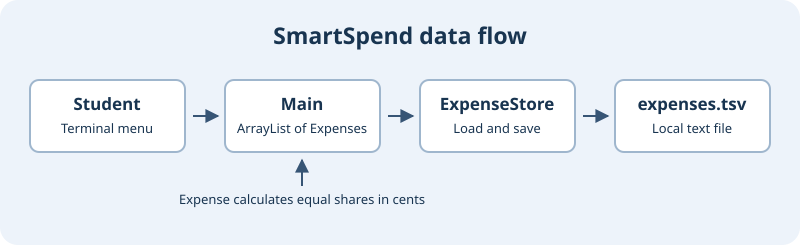

# SmartSpend

A Java terminal app for college students to record expenses, split bills, and see shared balances.

## The Problem

Roommates and friends often take turns paying for meals, rides, and groceries. SmartSpend keeps those payments in one place and calculates what each person owes or is owed.

## How It Works

`Main` reads menu selections with a `Scanner` and keeps an `ArrayList<Expense>`. `Expense` splits each shared charge into whole cents. `ExpenseStore` loads the saved entries at startup and appends each new entry to `expenses.tsv` in the working directory.



The payer receives credit for the full amount. Everyone listed in the split, including the payer if they participated, is charged a share. Names and categories are matched without regard to capitalization. Any extra pennies go to the first names listed. Personal expenses never affect shared balances.

## Tech Stack

- Java 17 or newer using the standard library
- `Scanner`, `ArrayList`, `LocalDate`
- Tab-separated local text file
- Git and GitHub for version control
- IntelliJ IDEA or a terminal and any editor

## Setup

1. Install a JDK (Java 17 or newer). Run `javac -version` and `java -version` in a terminal.
2. Run `git clone https://github.com/sachi-jain/smartSpend-.git SmartSpend` and then `cd SmartSpend`. If you already have the source, open a terminal in its SmartSpend folder.
3. Compile and run:

   ```sh
   mkdir -p out
   javac --release 17 -d out src/*.java
   java -cp out Main
   ```

For IntelliJ IDEA, open the SmartSpend folder, select a JDK of 17 or newer under **File → Project Structure**, then right-click `src` and select **Mark Directory as → Sources Root**. Open `src/Main.java` and run `Main.main` using the green triangle. Set the run configuration's working directory to the SmartSpend folder so both launch methods use the same data.

### Example

Choose **1** and enter the following values in order:

```text
10.00
Food
2026-11-15
Pizza
Sam
Sam, Alex, Jo
```

Choose **3** for shared balances:

```text
alex owes $3.33
jo owes $3.33
sam is owed $6.66
```

Exit with **0** and restart to see the saved entry under **2**.

## Roadmap

- [x] Record and view personal and shared expenses
- [x] Split shared expenses and calculate balances
- [x] Save and reload expenses from a local file
- [ ] Summarize monthly spending by category (Schedule feature)
- [ ] Add monthly budgets
- [ ] Track recurring expenses
- [ ] Export expense reports

## Project Planning

- [Eisenhower Matrix](2.1%20Eisenhower%20Matrix%20%E2%80%93%20SmartSpend.pdf)
- [Original program flowchart](SmartSpend%20Program%20Flowchart.png)
- [Development plan](docs/development-plan.md)

## Demo

Add the public link to your 3–4 minute video here after recording.
